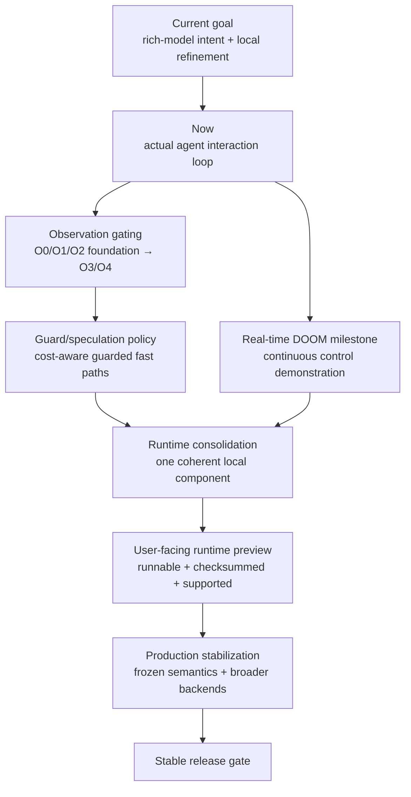

**Issue #57 success with UNKNOWN usage R05 - 2026-11-23 (main 8a9cb6d9):** A valid fake App Server response without usage retains caller TASK_SUCCEEDED and the synthetic effect receipt, while all five usage totals remain UNKNOWN and the frozen comparison projector returns HOLD. Custody audits; 17 assignments remain missing and dispatch is false. Focused 1/1 and module 9/9 pass normal and -O. Synthetic only. [R05](research/integration/issue57_v3_durable_appserver_composition_r05_20261123/RESULT.md).

**Issue #57 failed-turn UNKNOWN-usage R04 - 2026-11-23 (main d58deb08):** A fake App Server terminal failure with no tokenUsage event stays one failed attempt with exact call/thread IDs and all five usage totals UNKNOWN; durable custody audits, no execution/effect receipts are written, and task/run stay HOLD with dispatch false. Focused 1/1 and module 8/8 pass normal and -O. Synthetic only; live provider completeness and integrated efficiency remain open. [R04](research/integration/issue57_v3_durable_appserver_composition_r04_20261123/RESULT.md).

**Issue #57 provider success-to-custody R03 - 2026-11-23 (main 2cf4230f):** A synthetic valid JSONL provider turn traverses the real parser/model adapter, v3 caller, durable allocation, and registered ProspectiveRun custody with identity and five usage counters preserved. Focused test 1/1 and module 7/7 pass normal and -O; one task projects, but 17/18 assignments remain missing and dispatch is false. This is offline composition only; live provider completeness, matched efficiency, recovery reliability, and preview graduation remain open. [R03](research/integration/issue57_v3_durable_appserver_composition_r03_20261123/RESULT.md).

# Roadmap

**MAP01 target preflight R01 (current-main baseline `e67ca18c`, 2026-11-23):** A bounded read-only Windows check found no GZDoom at six standard paths and no command, process, or uninstall-registry entry. It did not search the whole disk or establish asset availability. No executable was launched and no runtime/assets were installed. Live #59 threat exposure remains pending an exact supplied/preinstalled target and IWAD/map. See [R01](research/integration/map01_preinstalled_target_preflight_current_main_r01_20261123/RESULT.md).

**Win32 public recovery writer-drain R05 (2026-11-23; frozen main `d5a378ec`):** The current-main exact Fake Win32 public recovery test passes 1/1 normally and under `-O`; the R04 report-temp/observation-timeout symptom did not reproduce in this focused case after the report-drain/close-wait change. R04 remains mixed at 7/10, and no reliability or live-input claim follows. Initial wrapper setup error stderr was overwritten before archival and is disclosed as a transcription; target outputs have an 18-entry manifest. See [R05](research/integration/standard_mcp_task_ledger_57_v1/current_main_public_recovery_writer_drain_r05_20261123/RESULT.md).

**Win32 public recovered-task repeat R41–R42 — 2026-11-23 (current main dc1f119bcb4094d0b58e70ffa273596f206c6c7a):** R41 and R42 each pass one frozen public standard-caller trial. Source A stays UNKNOWN/no-replay; public orphan recovery confirms release, neutral readback and the 2 s horizon; a distinct fresh HWND/PID generation completes a B task with one in-interval fixture event and public task_success=true; both fixture pairs close and the durable fence clears. R42's inherited R34 client-area label is retained as a visual caveat. The pair is not a reliability estimate, same-window continuation, arbitrary-app/MAP01/Calc evidence, integrated provider efficiency, or Research Preview graduation. Keep #57 open. See [R41](research/integration/win32_post_recovery_public_task_r41_20261123/RESULT.md) and [R42](research/integration/win32_post_recovery_public_task_r42_20261123/RESULT.md).

**Research Preview/#57 current-main R06 — 2026-11-23 (main 8554b2bf):** Current-main launcher preflight passes 19/19; launcher fixture tests pass 21/21 normal and optimized; preview builder and supported-host helper tests pass 11/11 both modes. The consent-aligned test fixture fix merged as PR #10490. Reusing the already-installed matching WSL venv raises current-main doctor to 13/15; only Windows Codex CLI JS and dependent codex_cli remain absent. Audit-retained passes RETAIN. The follow-up evidence merged as PR #10491. #58 remains blocked at supported-host doctor and still needs a fresh no-retry Golden run plus audit-live. No installs or live run occurred. For #57, the synthetic effect receipt handoff suite passes 60/60 normal and optimized, but live provider accounting, repeated reliability and matched efficiency remain open; R41–R42 pass two scoped public recovered-task cases.

See [R06 launcher packet](research/integration/research_preview_current_main_launcher_r06_20261123/RESULT.md), [R06 reused-venv packet](research/integration/research_preview_reused_pinned_venv_doctor_r06_20261123/RESULT.md), and [#57 handoff recheck](research/integration/standard_mcp_task_ledger_57_v1/effect_receipt_handoff_current_main_recheck_20261123/RESULT.md).

**Research Preview WSL acceptance R03/R04 — 2026-11-23 (frozen source `c5fc0ee0`):** The one-shot current-main runner passed static preflight then held at the explicit dependency-install opt-in; no environment was created. Default doctor passed 8/15; a temporary override to existing Windows Chrome passed its path check and raised the total to 9/15, without launching Chrome. Four Python modules and Windows Codex CLI JS are absent. The Windows Chrome-to-WSL bridge remains unverified. No runtime installation or live action occurred. Next qualify the browser/CLI path and resolve Python dependencies through authorized setup, then rerun doctor before the fresh no-retry task and `audit-live`. Keep #58 open. See [R03](research/integration/research_preview_current_main_supported_host_r03_20261123/RESULT.md) and [R04](research/integration/research_preview_current_main_supported_host_r04_20261123/RESULT.md).

**Win32 R24-R27 expiry/recovery boundary — 2026-11-23 (frozen source main `490d7bcb`):** R24, R26 and R27 produced factual fixture effects after a 2 s authority lease while source actions stayed UNKNOWN, release-unconfirmed and replay-denied; separate fresh-session orphan recovery verified key-up, neutral readback and a 2 s/77–78-sample horizon, then cleared each exact durable fence. R25 froze three attempts but stopped after one recovered dispatch and one pre-dispatch foreground mismatch; trial 3 was not attempted. R26 repeated the boundary once after explicit target activation; R27's three frozen attempts each passed Computer Use activation and exact HWND/PID foreground checks, then recovered successfully. The combined evidence is a bounded controlled fixture result, not a general reliability estimate, eligible task-success claim, MAP01 completion or efficiency comparison. Seven R24 research-adapter checks pass normally and under `-O`. These packets merged in [PR #10473](https://github.com/Unjuno/agent-interface/pull/10473). See [R24](research/integration/win32_expired_authority_delayed_effect_r24_20261123/RESULT.md), [R25](research/integration/win32_expired_authority_delayed_effect_r25_20261123/RESULT.md), [R26](research/integration/win32_expired_authority_delayed_effect_r26_20261123/RESULT.md), and [R27](research/integration/win32_expired_authority_delayed_effect_r27_20261123/RESULT.md).

**Issue #57 Calc composition boundary — 2026-11-23:** G10 remains a narrow two-effect live OCR positive control with UNKNOWN provider usage; do not retrofit or rerun it. R01 now passes a synthetic App Server failure/usage join through the v3 caller into durable Calc custody (2/2 normal and `-O`). R02 records four incomplete synthetic task envelopes through `ProspectiveRun`; all remain HOLD, finish reports 14 missing assignments, and dispatch remains disabled (two fresh repetitions per mode). R03 then passes the synthetic App Server failure/usage path through the v3 caller into a registered ProspectiveRun custodian (3/3 tests in normal and `-O`); custody audits successfully while the task and incomplete run remain HOLD. This is failure-path-only and does not use a live provider. R04 additionally passes synthetic `DEFERRED_UPSTREAM` with known usage and `FAILED_UPSTREAM` with usage UNKNOWN through the v3 caller and registered custody (4/4 in normal and `-O`). The deferred signal is caller-level synthetic, not an App Server/provider response. R06 now passes the complete offline 18-assignment `ProspectiveRun`: 18/18 custodians audited, all rows projected, evaluator reached `RETAIN`, dispatch stayed false (6/6 focused tests in normal and `-O`). The apparent token/time advantage is fabricated fixture input, not a measured comparison. Next verify a fresh exclusive live allocation and join real provider attempts, independent task scores, release/recovery and cleanup before dispatch. See [R04](research/integration/issue57_v3_durable_appserver_prospective_run_r04_20261123/RESULT.md), [R05](research/integration/issue57_v3_durable_appserver_prospective_success_r05_20261123/RESULT.md), and [R06](research/integration/issue57_v3_durable_appserver_full_trace_r06_20261123/RESULT.md). R24-R27 remain separate late-effect/recovery mechanics, not #57 success. See the [Calc evidence crosswalk](docs/maintenance/issue57-calc-evidence-bridge-audit-20261123.md), [R01](research/integration/issue57_v3_durable_appserver_composition_r01_20261123/RESULT.md), and [R02](research/integration/issue57_v3_durable_appserver_composition_r02_20261123/RESULT.md).

**Issue #57 current-main public MCP/Calc composition R03 (2026-11-23; main `066d70435fe19d0dc2690bc01a114e0912b20f87`):** The frozen Fake App Server/public-MCP/Calc-profile/FODS-score selector passes 1/1 normally and under `-O` on Windows CPython 3.11.9; its first import-path setup failure is retained. This recertifies synthetic composition only, not a live provider, eligible task success, recovery reliability, or efficiency. See [R03](research/integration/standard_mcp_task_ledger_57_v1/current_main_public_mcp_calc_composition_r03_20261123/RESULT.md).

This roadmap is ordered by research uncertainty, not by feature count.

**2026-11-23 post-merge checkpoint (main `1bf4d236`, PR #10470):** The
supervised-win32 observer is now bound per server; ordinary observer behavior
is preserved. R22 passes 94 focused ordinary/supervised MCP tests in both
modes. R23 passes ten fresh Fake public-recovery lifecycle attempts (5 normal,
5 `-O`) with callback, release/horizon and oracle identity evidence. This is
synthetic only; native task effect, real recovery reliability and integrated
efficiency remain open. Next run a fresh independently scored standard-caller
native task-effect/recovery trial. See [R23](research/integration/standard_mcp_task_ledger_57_v1/current_main_public_recovery_lifecycle_r23_20261123/RESULT.md).

**Recovery lifecycle diagnostic update — 2026-11-23:** R05 did not exercise its drain path; R06/R07 are failed designs; R08 verifies only a minimal delayed-observation Future drain. R09 (7/10) and R10 (8/10) remain mixed and cannot be classified as verified Fake-only because R10's optimized-02 orphan report came from real Win32 observation (`invalid HWND`, no input dispatched, owner call count zero). R11 failed on the wrong envelope oracle; corrected minimal R12 passed normal and `-O` and confirms only direct fake injection. The compiled-caller anomaly remains unresolved; instrument callback identity/raw response and detached worker state before freezing another lifecycle cohort. See [R05–R12 packets](research/integration/standard_mcp_task_ledger_57_v1/current_main_public_recovery_drain_r05_20261123/RESULT.md).

R13 passed the deterministic direct-observation Future-drain diagnostic once normally and once under `-O` (44.108 s and 46.170 s). Source review found a plausible, unproven late-executor-worker/test-patch race behind R10; retain the native invalid-HWND anomaly as unresolved and keep the R04/R09/R10 Fake-only classification withdrawn. The next gate is a stable per-invocation observer dependency plus retained caller worker/callback receipts before another lifecycle cohort. See [R13](research/integration/standard_mcp_task_ledger_57_v1/current_main_public_recovery_callback_future_drain_r13_20261123/RESULT.md).

**Current checkpoint — 2026-11-23 (main `19d4752e`, PRs #10467–#10469):** The public compiled caller composes automatic recovery, exact-call result lookup, and an independent task oracle only when separate recovery confirms the matching operation/generation, release, and late-input horizon. It preserves UNKNOWN source action and denies replay. Positive composition and negative controls pass normally and under `-O`. R04 ran ten fresh Fake lifecycle processes once: 7/10 passed; two action executions had unverified release and one observation missed its callback budget. A post-merge raw-log audit found an additional teardown `PermissionError` while deleting an in-flight report temp file; the writer identity and cause remain unproven. This fails the repeatability gate and is not a production reliability estimate. Research Preview still lacks supported-host doctor, fresh no-retry golden run, and `audit-live`; #57 still lacks repeated recovery reliability and matched all-attempt provider/token/latency/correctness accounting. Evidence is in the [project state index](docs/PROJECT_STATE.md), [R04 result](research/integration/standard_mcp_task_ledger_57_v1/current_main_public_recovery_lifecycle_r04_20261123/RESULT.md), [public recovery R02](research/integration/standard_mcp_task_ledger_57_v1/current_main_public_recovery_negative_controls_r02_20261123/RESULT.md), [public recovered-caller R01](research/integration/standard_mcp_task_ledger_57_v1/current_main_public_recovered_caller_r01_20261123/RESULT.md), and existing R06/R07/R08 task-effect packets. The latest full membership receipt r165 predates this main SHA and remains a dated snapshot, not a fresh queue count.

For the concise project-wide gate and repository-organization status, see the
[project state dashboard](docs/PROJECT_STATE.md).

**Research Preview current-main WSL acceptance prefix R02 (2026-11-22; main `10b47b4b4edf283ed2b28f19bbeb9de4b9cf9b51`):** Official acceptance preflight passed 19/19 on the Ubuntu WSL2 host. The existing venv was absent; the setup command, invoked without `--install-dependencies`, correctly refused with exit 2. The runner stopped before doctor and retained audit; no dependency install, GUI, model, or live allocation occurred. Issue #58 remains open. See [R02](research/integration/research_preview_rc1_setup_doctor_r05_20261121/current-main-prefix-r02-20261122/RESULT.md).

**Research Preview frozen-source audit repair candidate `2552fe76` (2026-11-22; base main `128c33f2`):** The retained audit verifies its 29 historical source files from the byte-exact archive and preregistration, reports seven later content changes separately, and packages the archive. Local runtime and bundle-builder tests pass 5/5 normally and under `-O`; current retained audit passes. This is an offline packaging/audit repair only; #58 still lacks supported-host setup, a fresh no-retry run, and `audit-live`. See [R01](research/integration/research_preview_retained_source_audit_r01_20261122/RESULT.md).

**Win32 R16 orphan recovery with native late-input horizon (2026-11-22; frozen main `8a3085c0e494eab0214b72c3564841c13c4fe62e`):** One public orphan-recovery call resolved the exact R14 UNKNOWN custody record on a distinct fresh Win32 generation. SHIFT-up and the 2 s/78-sample native horizon passed (maximum sample gap 32 ms); the old action remained UNKNOWN, task success null, replay denied, and both generations fenced. No task action/effect was produced. Raw runner classification is preserved alongside a separate 15-check adjudication; four focused tests pass 4/4 normally and under `-O`. This closes only the scoped orphan-custody recovery case, not standard-caller recovery task success, repeated reliability, MAP01, integrated efficiency, or runtime graduation. See [R16](research/integration/win32_native_sendinput_recovery_20261122_r16/RESULT.md).

**Issue #57 recorded Win32 effect R08 (2026-11-22; live source main `7bcf4a795e71a466e004b066bfb48f0fcb2d5491`; repairs merged by PR #10451 at `7075902b6dd95da57a2e25819e2d2d6859239c25`):** One frozen no-provider fixture action completed through public observe/dispatch/results/observe/close. Independent text effect `a`, release, and the 2 s/78-sample late-input horizon passed; public `task_success` remains null. The original live runner failed only while building the canonical ledger after close. Offline reconstruction from preserved recorder requests/responses passed using the subsequently merged adapter repairs; the normal and `-O` five-suite sets pass 70/70 each. This adds no matched efficiency, expiry-after-action, recovery/reliability, MAP01, or Research Preview evidence. Preserve R07's pre-dispatch failure and R08's excluded attempts. See [R08](research/integration/win32_recorded_task_effect_r08_20261122/README.md) and [R07](research/integration/win32_recorded_task_effect_r07_20261122/README.md).

**Issue #57 public action identity join R01 (2026-11-22; local candidate from main `f5c87f4b`):** The recorded comparison and effect handoff adapters previously assumed the recorder's MCP boundary ID equaled the server-generated public action ID. They now resolve exactly one retained `interface_dispatch` by its public response body ID while retaining independent recorder IDs for call journaling and order. The completed-action and recorded Relay recovery cases exercise different IDs. Five local suites pass 68/68 normally and under `-O`. Synthetic only; next validate a fresh live run with recorder boundary capture and construct its canonical measured-run. See [R01 evidence](research/integration/standard_mcp_task_ledger_57_v1/public_action_id_join_r01_20261122/README.md).

**Issue #57 fresh public Win32 task-effect fixture R06 (2026-11-22; main `d8ad74eb`):** One fresh supervised caller run completed exact public dispatch and result lookup, bracketed the delayed fixture effect with two public observations on the same target generation, independently scored text `a`, and verified release plus the 2 s late-input horizon (78 samples, max gap 32 ms / 100 ms bound). Public `task_success` remains null. Five local integration suites pass 67/67 normally and under `-O`. This is one no-provider fixture run, not an efficiency/recovery/reliability/MAP01 or preview result. Raw MCP PNGs, exact result, oracle events and excluded setup attempts are retained in [R06](research/integration/win32_public_task_effect_r06_20261122/README.md). Next adapt the retained run into the canonical comparison/task-effect ledger, then run a separately frozen recovery trial.

**Issue #57 public Win32 task-effect capture pair R02 (2026-11-22; local candidate from main `1542df47`):** The effect-receipt adapter now joins public `interface_observe` before/after capture IDs, generation, intervals and PNG custody to one exact action/result, independent score, and owner release/horizon. Effect intervals must fall between capture windows. Focused tests pass 19/19 and the combined handoff/reuse/attribution/comparison/adapter suite passes 67/67, normally and under `-O`. Synthetic only; raw outputs and source hashes are in [R02](research/integration/standard_mcp_task_ledger_57_v1/public_win32_effect_pair_handoff_r02_20261122/RESULT.md). Next run a frozen fresh standard-caller fixture and preserve all failures.

**Issue #57 public Win32 observation measurement handoff R01 (2026-11-22; local candidate from main `04ad2956`):** The research comparison validator and recorder adapter now accept `interface_observe` through exact capture ID, target generation, capture interval, and decoded PNG bytes/digest. The focused suites pass 38/38 normally and under `-O`; the combined handoff/reuse/attribution/comparison/adapter suite passes 64/64 in both modes. Raw logs and source hashes are retained in [R01](research/integration/standard_mcp_task_ledger_57_v1/public_win32_observation_handoff_r01_20261122/RESULT.md). Synthetic only: no R05 conversion, exact action/result/effect/release join, live input, provider accounting, or efficiency result. Next bind before/after observations to one dispatch and independent task scorer before freezing a fresh finite caller trial.

**Research Preview acceptance-runner repair merged (2026-11-22; main `d1a92e04c47b4dbf88e4c784c3dfdfea16bb8e10`):** PR #10440 makes the supported-host acceptance prefix reuse an existing golden venv and requires explicit `--install-dependencies` before setup can install one. The focused acceptance-runner and package-builder suites pass 9/9 normally and under `-O` on the merged main; replay-gate passed and the formal check was skipped. Actual WSL Chromium and Windows Codex CLI JS remain unverified, so setup/doctor and the fresh no-retry golden acceptance gates remain open. Details: [Issue #58 update](https://github.com/Unjuno/agent-interface/issues/58#issuecomment-7075513226).

**Research Preview current-main runner R01 (2026-11-22; frozen RC1 `8e5052e0`):** The merged acceptance runner passes 19/19 launcher preflight checks, reuses the existing venv without dependency installation, and retains a doctor HOLD at 12/15 because Windows Codex CLI JS and WSL Chromium are absent (`codex_cli` fails downstream). No retained audit or live allocation ran. Preserve the gate as open; see the [R01 result packet](research/integration/research_preview_rc1_setup_doctor_r05_20261121/current-main-runner-r01/RESULT.md).

**Research Preview current-main prefix R02 (2026-11-22; main `10b47b4b4edf283ed2b28f19bbeb9de4b9cf9b51):** Official setup preflight passes 19/19 and the acceptance runner correctly refuses implicit dependency installation. Supplemental read-only doctor is 12/15; retained audit fails on seven source hashes. Keep Research Preview on HOLD pending explicit setup/prerequisite resolution and source-custody diagnosis. No live allocation was used. See the [R02 packet](research/integration/research_preview_rc1_setup_doctor_r05_20261121/current-main-prefix-r02-20261122/RESULT.md).

**Issue #57 Win32 fixture R05 (2026-11-22; main `ee14863bec0c7a222bec4d96300162afde61cf82`):** Third fresh standard-caller fixture pass: action completed, release verified, 2 s/77-sample late-input horizon passed, and independent fixture text effect `a` appeared after 6.015 s. Public `task_success` remains null and replay denied; no recovery or model/provider call occurred. Focused backend/producer/MCP suites pass 27/27 in normal and `-O`. This adds a scoped repeat only, not reliability, MAP01, or efficiency evidence. See [the R05 packet](research/integration/win32_current_main_fixture_effect_r05_20261122/README.md).

**Issue #57 normal-completion effect-handoff R01 (2026-11-22; from main `0b97018d`):** The research-only effect adapter now validates normal completed-action receipts with exact dispatch/result identity, authority expiry, verified release, and neutral late-input horizon while retaining the existing recovered-action path. The combined 26-test handoff, reuse-horizon and effect-timing suites pass normally and under `-O`. They verify post-expiry ineligibility, reject missing horizon verification, and allow normal release before a later lease expiry when the task effect remains inside authority. This is synthetic only and does not adapt R05, which lacks an `interface_results` call and before/after public capture pair. No live input or provider call. [R01 evidence](research/integration/standard_mcp_task_ledger_57_v1/completed_owner_handoff_r01_20261122/README.md).

**Issue #57 offline effect-handoff gate (2026-11-22; main `371cbca8`):** The research-only effect receipt handoff, recorded comparison adapter, and measurement validator pass 42/42 on Windows CPython 3.11.9 normally and under `-O`. This verifies score/capture identity, action/generation binding, authority-expiry/release/horizon bands, unknown/post-horizon ineligibility, and correctness-qualified break-even handling. PR #10437 preserves the exact raw, conditions and hashes. This closes the offline adjudication contract only; the live standard caller is not yet wired to submit a complete capture/effect/release/horizon receipt, and actual provider usage remains unreconciled. See [the current-main packet](research/integration/standard_mcp_task_ledger_57_v1/outputs/effect-handoff-current-main/RESULT.md).

**Issue #57 current-main Calc composition (2026-11-22; main `3d1ce3ab`):** The focused synthetic Fake X/provider-planner/public-MCP test passes 1/1 in both normal and `-O` Windows runs. An older `897f4896` worktree failure was a fixture setup omission; unmodified current main passes. PR #10436 retains exact bytes and scope. This does not add live GUI/MAP01, recovery reliability, efficiency or Research Preview evidence. See [the current-main packet](research/integration/standard_mcp_task_ledger_57_v1/outputs/r164-latest-main-baseline/RESULT.md).

**Current-main Win32 receipt-capacity repair (2026-11-22):** The standard prestarted producer allocates a maximum-capacity receipt buffer, while the backend previously required exact equality to the current program length. R03 now passes one public caller fixture action, verified release, 2 s late-input observation and independent delayed application effect; focused normal/`-O` suites pass 24/24 each. The separate R01 UNKNOWN and R02 foreground refusal/recovery records remain intact. This is a scoped fixture result, not MAP01, matched efficiency, repeated reliability or preview graduation. See the [R03 packet](research/integration/win32_current_main_fixture_effect_r03_20261122/README.md) and [repair diff](runtime/backends/win32_v1/backend.py).

R04 independently repeated the same foreground-bound fixture protocol with a fresh HWND/PID and again observed completed action, verified release, the 2 s no-late-input horizon, and 6 s application effect. Two successes do not establish a reliability rate. See [R04](research/integration/win32_current_main_fixture_effect_r04_20261122/README.md).

The read-only worktree custody snapshot after PR #10427 is in
[`worktree-custody-recheck-20261122.md`](docs/maintenance/worktree-custody-recheck-20261122.md): 15 worktrees, five dirty; unique outputs and raw evidence remain preserved.

## Latest full inventory checkpoint r163 — 2026-11-22 JST

Complete paginated reads bracketed by current main `1afb532ea153f3da3906764753909fac074afce3` found 1,640 open Issues and 407 open PRs. Compared by exact ID against r152/r157, there were no additions; Issues #7748/#7765/#7817 and PR #8181 are the only removals. This matches r162 membership. Membership is not semantic triage or custody reconciliation. See the [r163 receipt](docs/maintenance/repository-inventory-recheck-20261122-r163.md), [the r160 crosswalk](docs/maintenance/idea-index-crosswalk-20261121-r160.md), and [the current work map](docs/WORKER_WORK_MAP.md).

## Prior full inventory checkpoint r162 — 2026-11-22 JST

Complete paginated comparison against r160, captured at main `ed0798d45d3bb7b839015619cd81f30e292a7583`, found 1,640 open Issues and 407 open PRs: no additions; Issues #7748/#7765/#7817 and PR #8181 are the only removals. A second full page sweep after docs PR #10423 merged, bracketed by main `8e4ac52d664fbba306fbd1af4b1c2e0dd9eaf0d2`, found the same counts and exact sets. The r160 semantic crosswalk remains the latest full routing analysis, while targeted dispositions are appended there. Issue #57's matched live efficiency, standard-caller task success, and repeated recovery reliability remain open, as do Research Preview graduation and distributable-runtime acceptance. This is membership evidence, not semantic triage or custody reconciliation. See the [r162 receipt](docs/maintenance/repository-inventory-recheck-20261122-r162.md), [the r160 crosswalk](docs/maintenance/idea-index-crosswalk-20261121-r160.md), and the [r162 work-map](docs/WORKER_WORK_MAP.md).

## Prior full inventory checkpoint r161 — 2026-11-22 JST (main `f75b34bc00b125c8cb6f106ea43835cea1401e2e` before/after)

Complete paginated comparison with r160 found 1,641 open Issues and 407 open PRs: no additions; #7748/#7765 and #8181 are the only removals. PR #10418 merged the targeted B13 dispositions and #8859 trace-classification feasibility result. R01 classified all six calls in one retained synthetic successful trace as required, but found no matched pair and no basis for a preference assay. The r160 semantic crosswalk remains the latest full routing analysis; its route counts are a dated snapshot. Issue #57's live matched efficiency, standard-caller task success and repeated recovery reliability gates remain open, as do Research Preview graduation and distributable-runtime acceptance. This membership check is not semantic triage or custody reconciliation. See the [r161 receipt](docs/maintenance/repository-inventory-recheck-20261122-r161.md), [R01 audit](research/integration/standard_mcp_task_ledger_57_v1/efficiency_trace_feasibility_r01_20261122/RESULT.md), and [r160 crosswalk](docs/maintenance/idea-index-crosswalk-20261121-r160.md).

## Prior full inventory checkpoint r160 — 2026-11-21 (captured at main `f39e966b6478170a7a91f1eec7859d30046784bf`; crosswalk base `87f1afe2ad2202a3a5200a4add86190e9f6a1496`)

Complete paginated reads, bracketed by the same main SHA, found 1,643 open Issues and 408 open PRs, exactly matching r159. PRs #10402/#10403 had merged before r160; since then #10404–#10414 have opened and merged without Issue-state changes. PRs #10404–#10414 update documentation only, so the r160 Issue set remains applicable. The B01–B12 navigation crosswalk remains nonsemantic; #2369's local-check policy is nonbinding and calls for relevant local checks plus a record of unavailable hosted-only checks. B08 confirms #2679's prior short probe was not a model-in-loop terminal clear and #3382's closure was scoped to a caller source audit. B09 and B10 are routing plus scoped reads; #6693's paired Docker/WSLc comparison remains on hold for shared-runtime/source ownership. B11 confirms #6990's closure is narrow and does not clear earlier WSLc STOPs. B12 confirms #7430 retains the #7970 no-WSLc-command boundary, #7466's formal failure remains, and #7709 is synthetic-method evidence. This count is not semantic triage or evidence-custody reconciliation. Issue #57's matched efficiency, standard-caller task success and repeated recovery reliability gates remain open; Research Preview graduation and distributable-runtime acceptance also remain open. See the [r160 receipt](docs/maintenance/repository-inventory-recheck-20261121-r160.md) and the [current-main idea-index crosswalk](docs/maintenance/idea-index-crosswalk-20261121-r160.md).

**Current-main Fake X late-DOWN regression (2026-11-21):** one existing process-cancellation test passes normally and under `-O`, asserting UNKNOWN/no-replay and persistent owner fencing after delayed synthetic DOWN during recovery. It does not confirm physical release. Raw transcripts and exact conditions are preserved in [R01](research/integration/currentmain_fake_x_delayed_down_recovery_r01_20261121/RESULT.md).

**Current-main lease-expiry refusal (2026-11-21):** the existing Win32 backend test passes normally and under `-O`, distinguishing a post-expiry refused button-DOWN by receipt phase. Native dispatch and physical release are not exercised. See [R02](research/integration/currentmain_fake_x_expired_down_refusal_r02_20261121/RESULT.md).

## G10 comparison-boundary audit — 2026-11-21 (frozen on main `ce6449f38a56e1731f01d1024837fb34c9c759a3`)

The retained Calc G10 record is a scoped positive control, not a matched efficiency arm. The read-only audit verified all 33 declared source hashes and 69 retained run files; current `recorded_comparison_adapter_v1` rejects the unmodified G10 raw record as lacking a reconciled caller receipt. Provider usage remains UNKNOWN and cannot be inferred as zero. The next #57 economics experiment needs a fresh preregistered matched block using the standard caller and all-attempt accounting. See [the crosswalk and audit](research/integration/g10_current_main_comparison_readiness_20261121/RESULT.md). No GUI or provider action was run.

## Prior checkpoint — 2026-11-21 (after PR #10396; main `2f50f48ce69cfd72a22bb74fee4b6dd1d77fd1eb`)

**Issue #57 composition checkpoint (PR #10396):** Merged to main as 2f50f48ce69cfd72a22bb74fee4b6dd1d77fd1eb. The retained effect-score adapter output composes into the reuse-horizon evaluator; 33 focused tests pass normally and under -O. This closes only a synthetic offline connection check. Live matched efficiency, standard-caller task outcome/recovery reliability, and Research Preview graduation remain open. See [the packet](research/integration/standard_mcp_task_ledger_57_v1/effect_receipt_reuse_horizon_20261121/README.md).

**Research Preview RC1 setup and doctor (R05, 2026-11-21):** The frozen RC1 checkout installed its nine pinned Python dependencies successfully into an isolated WSL venv. Its doctor exited 1: 12/15 checks passed; the required Windows Codex CLI JS and WSL Chromium were absent, making the `codex_cli` check fail as a consequence. No app/runtime/model acquisition or GUI action occurred. This is a reproducible setup HOLD, not a golden run or preview acceptance. See [R05 evidence](research/integration/research_preview_rc1_setup_doctor_r05_20261121/RESULT.md). Issue #58 remains open.

**Whole-repository membership refresh r154 (2026-11-21):** On main `8c71a6199bd51ca6b38aa02cb92d9833c3260a67`, the complete paginated open sets are still 1,643 Issues and 410 PRs, exactly matching r153/r152 membership; main was unchanged before and after. This is queue membership only, not semantic triage or merge readiness. The current organization plan records this comparison; no bulk closure follows. #5130 is the one-time six-task Mindustry three-arm economics allocation under #57, still gated on its frozen source/resource conditions; #7924 remains the explicit WSLc migration STOP.

## Issue #57 caller v3 + compiled GUI composition R01 - 2026-11-23

On current main c4065d011e1297ebd589bcd5b85da3beb269e037, the shared adaptive caller v3 now has a composed synthetic path through runtime.core_v1.compiled_gui. The positive path records two complete-cold model attempts, executes two local evidence-selected transitions with zero internal frontier resumptions, and sends program completion to a distinct synthetic task scorer. The changed-intermediate path keeps the first action/release, refuses the second admission/input, and returns EXECUTION_INCOMPLETE / unknown_state / confirmed_partial. Focused composition tests pass 2/2; the caller v3 suite plus 17 compiled-runtime suites pass 132/132 normal and 132/132 under -O on Windows CPython 3.13.14. The first bundle's legacy top-level import setup failure is retained and excluded. This is synthetic composition only; live app/provider/accounting/economics remain open. See [R01 result](research/integration/issue57_adaptive_caller_compiled_gui_composition_r01_20261123/RESULT.md) and [composition plan/crosswalk](docs/maintenance/issue57-composition-plan-and-requirement-crosswalk-20261123.md).

## Issue #57 interrupted-terminal usage custody R07   -  2026-11-23

On current main f64c58179524db4be64b116a265182c9facc1736, one synthetic JSONL turn emitted observed usage then terminated with status interrupted. Exact turn/thread identity and all five usage counters survived the real parser/model/v3/durable allocation/ProspectiveRun path; the failed attempt produced no task receipts, task/run stayed HOLD, and dispatch stayed disabled. Focused 1/1 and full module 11/11 passed normal and -O on Windows CPython 3.13.14. A broken optimized runner invocation is preserved but excluded; corrected optimized runs pass. This is synthetic custody coverage only. See research/integration/issue57_v3_durable_appserver_composition_r07_20261123/RESULT.md. Keep #57 open; live provider, efficiency, caller recovery and runtime gates remain open.

The active completion goal is to qualify the distributable runtime and the
research gates below; this roadmap is a navigation/status summary, not a new
experiment allocation.

**2026-11-23 update:** Observer-binding R14/R15 focused tests pass in both
Python modes, but full-module R16 fails in both modes (normal 12 errors;
optimized 12 failures + 16 errors) with timing and temporary-file/cleanup
interference. Do not treat the candidate as broadly verified yet. Retained
details: [R16 result](research/integration/standard_mcp_task_ledger_57_v1/current_main_public_recovery_observer_binding_suite_r16_20261123/RESULT.md).

R19 reproduced long cleanup failures with `D:\CodexData\Temp`; R20 passed all
63 tests normally and under `-O` on dedicated C: TEMP (116.525 s / 118.401 s).
Treat the C: result as the candidate's qualified local suite and keep the D:
failure as a host-storage confound. See the [R19 comparison](research/integration/standard_mcp_task_ledger_57_v1/current_main_public_recovery_temp_volume_r19_20261123/RESULT.md)
and [R20 full suite](research/integration/standard_mcp_task_ledger_57_v1/current_main_public_recovery_observer_binding_suite_ssd_r20_20261123/RESULT.md).

The initial CI run found the binding was also applied to one-shot MCP, breaking
five existing tests that replace the observer after server construction. The
final candidate narrows binding to `supervised-win32`; the ordinary observer
lookup remains unchanged. R21's first combined run had one WinError 267 due to
its deep TEMP path. R22 passes both affected modules, 94 tests in normal and
`-O`, with a short C: TEMP. See [R22](research/integration/standard_mcp_task_ledger_57_v1/current_main_public_recovery_scope_corrected_combined_r22_20261123/RESULT.md).

- **Portable package:** Windows and Ubuntu WSL deterministic package/startup
  checks pass 21/21 normally and under `-O`; outside-checkout `doctor` and
  `validate --help` pass with side-effect authority disabled. See the
  [earlier package packet](research/integration/portable_runtime_distribution_v2_current_main_20261121/RESULT.md).
  PR #10377 added a second independently rebuilt package pinned to runtime
  source main `acbdfc0f9`; its tests pass 21/21 normally and under `-O` on
  Windows, the outside-checkout CLI starts on Windows and WSL, and 64/64
  source hashes audit clean. The evidence-only merge did not change runtime
  source. See the [current-main packet](research/integration/portable_runtime_distribution_v2_current_main_acbdfc0f9_20261121/RESULT.md).
  This does not establish live X11/Win32 input, task effect, public release,
  or research-preview acceptance.
- **Mindustry setup:** the pinned v160.2 JAR and both canonical saves match
  their recorded sizes and hashes. The full JAR archive CRC check passes, but
  Ubuntu WSL has no Java runtime, so the game was not launched. See the
  [asset-readiness packet](research/integration/mindustry_asset_readiness_v1_20261121/RESULT.md).
- **Integrated control and efficiency:** Issue [#57](https://github.com/Unjuno/agent-interface/issues/57)
  remains open for recovered-task success on the standard caller, repeated
  reliability, and matched all-attempt model/provider token, latency, and
  correctness accounting. Single MAP01 effects and the late-usage adapter do
  not close these gates.
- **Research Preview:** Issue [#58](https://github.com/Unjuno/agent-interface/issues/58)
  remains open. A current-main read-only launcher preflight passed 19/19 on a
  fresh sparse Ubuntu WSL ext4 checkout; the Windows-mounted checkout retained
  four line-ending/worktree-byte failures. This is not the frozen RC1 host
  acceptance. The release sequence in [`release/README.md`](release/README.md)
  still requires setup/doctor, retained audit, one fresh no-retry persistent
  run, and `audit-live`. See the
  [preflight packet](research/integration/research_preview_preflight_current_main_20261121/RESULT.md)
  and latest Issue #58 acceptance record.
- **Allocation and queue:** #5130's named Docker CPU lane and #7924's WSLc
  client ownership remain unresolved; #908 is a consumed historical HOLD.
  PR #10340 is merged as a dispatch-disabled prospective journal; the external
  allocation attestor and fresh exclusive comparison allocation remain absent.
  The latest whole-repository membership snapshot is
  [r158](docs/maintenance/repository-inventory-recheck-20261121-r158.md):
  1,643 open Issues and 408 open PRs. This is not semantic triage and does not
  justify bulk closure.

**Whole-repository membership refresh r155 (2026-11-21):** On main
`63449e8abed5938a780de22cabc160aefd9d3326`, complete paginated REST reads found
1,643 open Issues and 409 open PRs. Issue IDs exactly match r152; the only PR
membership delta is #10218 removed. PR #10377 was opened and merged during the
interval but had no residual membership effect. This is queue membership only,
not semantic triage or merge readiness; no bulk closure follows. See the
[r155 receipt](docs/maintenance/repository-inventory-recheck-20261121-r155.md).

**Issue #57 isolated X11 delayed-input gate (2026-11-21):** WSL TCP-only Xvfb
recheck R01 is retained as `HOLD_TRANSPORT_IDENTITY`: XRes could not map the
remote client to a unique PID, so the queue discriminator did not run. The
separate Docker private-Unix-socket Xvfb pair R02b passes in normal and `-O`:
both runs confirmed owner disconnect, held-key readback, independent release,
no delayed KeyPress at 8.5 s, and final all-keys-up. This is synthetic XTEST
evidence only. Standard caller recovery, task effect/success, reliability,
matched efficiency and live MAP01 remain open. See the
[R01 packet](research/integration/standard_mcp_task_ledger_57_v1/current_main_xvfb_tcp_queue_recheck_20261121_r01/RESULT.md)
and [R02b packet](research/integration/standard_mcp_task_ledger_57_v1/current_main_docker_xvfb_unix_queue_recheck_20261121_r02b/RESULT.md).

**Issue #57 standard caller blocked-release result (2026-11-21):** The current
public MCP/Xvfb path reproduced a 150 ms XRes supervision timeout in optimized
mode 4/4 attempts; each remained UNKNOWN and skipped release. A one-second
diagnostic returned XRes disconnect in 199.5 ms. During the deliberately
withheld cancel acknowledgement, the old A key remained held and generated
repeated A KeyPress/KeyRelease effects; the scheduled delayed B KeyPress was
not observed. The evidence-backed 500 ms
candidate passed the exact standard-caller test and XRes unit suite in normal
and `-O`: it returned a bounded pending response, verified release, retained
the old operation as UNKNOWN/no-replay, and reported the old task as failed from repeated effects while A remained
held through the cancel acknowledgement (effect count 1→4 normal, 1→19
optimized); the scheduled delayed B KeyPress was not observed. A distinct fresh-generation task
passed exactly once with no old-input contamination. See the
[R01–R04 baseline/diagnostic packets](research/integration/standard_mcp_task_ledger_57_v1/current_main_standard_mcp_xvfb_blocked_release_recheck_20261121_r01/RESULT.md)
and the [500 ms candidate packet](research/integration/standard_mcp_task_ledger_57_v1/current_main_standard_mcp_xvfb_blocked_release_candidate_500ms_20261121_r01/RESULT.md).
This candidate improves bounded recovery evidence; delayed effects on the
original task remain a failed gate. #57 stays open.

The next work must advance one scoped gate at a time, retain failures and
unknowns, and re-read current source and ownership before any live or shared
resource action.

For active task priority, use [CURRENT_GOAL](docs/CURRENT_GOAL.md) and the
[worker work map](docs/WORKER_WORK_MAP.md). The current maintainer priority is
repository convergence that enables independent research and verified integration;
computer control and human-tempo operation remain unresolved objectives.
The [native Win32 fixture UI trial](research/integration/win32_native_fixture_live_20261026_r01/RESULT.md)
adds one scoped current-main click/text/save effect and verified-release sample;
MAP01/real-game transfer, standard-caller composition, blocked-I/O recovery,
matched efficiency, and reliability remain open.
The [R270 current-main public-caller attempt](research/integration/map01_r270_current_main_caller_start_20261116/REPORT.md) exposes a prestart deadline boundary: producer startup took 30.031 s against a 30 s lease, so all program operations stayed not-started and the source action remains UNKNOWN. Fresh-session R272 recovery reconciled custody as not_dispatched and fenced the generation. This is not a caller/automatic pair or task-effect/efficiency result; #57 remains open. The [R266 automatic MAP01 expiry trial](research/integration/map01_r266_current_main_expiry_20261116/REPORT.md) separately passed scoped release, delayed-operation exclusion and calibrated HUD-effect gates once, with a result-metadata deviation.
The fresh current-main [MAP01 expiry pair R198/R199](research/integration/map01_win32_current_main_expiry_r198_r199_20261116/REPORT.md) now includes a corrected preregistered single-action effect/recovery result (R199: 50→49, confirmed release and neutral horizons). R198's stale source-projection expectation remains recorded as a condition deviation. This narrows the live-control boundary but does not satisfy #57's matched model/provider lifecycle accounting, reliability or task-completion gates.
The later unused [R264 expiry freeze audit](research/integration/map01_r264_expiry_freeze_audit_20261117/REPORT.md) found that its frozen runner implements exception recovery rather than the described 30 s expiry/60 s delayed-input trial; its source pin also predates 37 changed runtime files. R264 was not run. R266 now supplies one fresh current-main automatic expiry/effect observation; its result-label defects and the missing caller/provider efficiency comparison remain open.
The separate [expiry-caller block R241/R242 audit](research/integration/map01_win32_expiry_caller_r241_r242_20261115/REPORT.md) preserves a scoped R241 automatic-monitor pass and R242 public-caller pre-input failure. The preregistered stop rule was applied, leaving R243–R248 unattempted. The pair used old source and R242's initial raw manifest has custody gaps; it establishes no current-main pair or efficiency result.
The separate [Freedoom MAP01 probes](research/integration/win32_freedoom_map01_live_20261026/README.md)
show one scoped forward effect with a verified runtime release receipt. Two
fresh input attempts showed material scene motion through the +2 s sample and
failed the preregistered sampled-settle gate; a fresh zero-input control stayed
stable over the same nominal interval. This supports input-associated delayed
application/game response but does not prove causality or qualify continuous
stop timing, blocked-I/O release, recovery, standard-caller integration, or task
success.
The subsequent [R04 held-callback cancellation run](research/integration/win32_freedoom_blocked_cancel_map01_20261026_r04/RESULT.md)
passed one live standard-caller cancellation/recovery trial: the hook callback
returned after cancellation released it, recovery completed within its runtime
deadline, release was confirmed, replay was denied, and a generation-bound MAP01
effect passed an independent oracle. R01–R03 remain retained observation misses.
This is one scoped result, not a reliability rate, MAP01 clear, or efficiency
comparison; the full raw packet remains local and its manifest hash is published
with the sanitized derivative.
[Issue #59](https://github.com/Unjuno/agent-interface/issues/59) tracks real-time
control. Neither this roadmap nor an unchecked item grants a new allocation or
changes a retained result.

Integration direction recorded 2026-09-19: [integrate one usable desktop path](docs/INTEGRATION_PLAN.md)
from the existing components, following [the updated goal](docs/CURRENT_GOAL.md)
and Issue #57. Other contributors continue research/benchmarks; this task focuses
on setup, observation, guarded action, useful results and recovery through one
coherent entry path. Use the
[convergence review](research/evolution/freeze_criteria.md) to end discovery;
the sections below remain a backlog, not automatic implementation instructions.
## Roadmap at a glance

This diagram is a reading/promotion map of the existing sections, not a claim that every item must execute serially or that a later box is already qualified.

## Now — actual agent interaction loop

The scoped O1/O2 studies and actual assistant use are summarized in the
[research handoff](docs/LOCAL_RESEARCH_HANDOFF.md). Local feedback in tens of
milliseconds has not yet produced a human-like end-to-end operating tempo.

Public-path checkpoint (2026-09-30): [the retained six-task comparison](runtime/results/public-six-task-comparison-04/README.md)
completed direct and guarded public MCP routes with six exact-once saves each.
This fills the completed public direct-baseline accounting gap, while overall
integration remains HOLD: one final image lacks the completion cue, image delivery
and capture placement differ, and serial order plus growing context prevent causal
speed/token ranking. Useful-feedback onset, broad reliability and human tempo
remain open; the historical allocations and checklist below are unchanged.

- [ ] Persistent asynchronous execution and incremental observations.
- [ ] Bounded input holds, cancellation/release and stale-state handling.
- [ ] Guarded local progress that eliminates unnecessary agent/tool round trips.
- [ ] Same-model live measurements of task quality, completion latency and actual tokens.
- [ ] Comparable human operating-tempo measurements.

## Observation Gating — scoped foundation and remaining work

Goal: remove visual/model input that carries no new task-relevant information while keeping correctness as a hard gate.

- [x] Freeze O0: full screenshot after each logical step (A1 scoped baseline).
- [x] Add O1: exact unchanged-frame suppression (A1 scoped pass).
- [x] Add O2: exact changed-tile / spatial-delta feedback (A2 transport-only pass).
- [ ] Add O3: relevant-region gating.
- [ ] Add O4: local `VERIFY` before model escalation.
- [x] Measure local action-to-first-feedback latency; full agent latency remains open.
- [x] Measure image-observation elimination at equal correctness in A1's four-app suite.
- [x] Stress tiny but semantically important changes so approximate hashes cannot silently hide them ([#1564 retained scoped PASS](research/measurement/observation_tiny_change_ahash_v1/REPORT.md)).

Active track: [`research/observation_gating/`](research/observation_gating/).

## Next — automatic speculation and guard policy

- [ ] Estimate guard cost vs `P(stale) × failure cost` per route.
- [ ] Automatically select pre-execution guard vs postcondition-only verification.
- [ ] Continue separating binding, precondition, route, observation-cache, and motor-calibration lifetimes.
- [ ] Run longer multi-app sessions with focus drift, window replacement, modal transitions, and geometry changes.

## Demonstration milestone — real-time DOOM

User direction (2026-09-13): once the live control foundation is usable, have
the assistant play DOOM in real time and develop a Product Hunt demonstration.
This extends the human-like operating-tempo objective; it does not replace
ordinary desktop task correctness or establish that capability by itself.

- [ ] Establish persistent observation/action delivery, bounded held inputs,
  cancellation/release and stale-observation handling before an extended run.
- [ ] Start with navigation and turning, then navigation under moving threats,
  then a short repeatable gameplay objective. The assistant chooses actions
  from current visual observations through Agent Interface.
- [ ] Keep the game progressing at ordinary wall-clock speed during reasoning.
  Report game speed, render rate, capture rate, observation age, decision rate,
  action duration and action-to-visible-effect latency separately.
- [ ] Compare interfaces with the same model, map/seed schedule, difficulty,
  resolution and action capabilities. Keep failed episodes and measure success,
  survival/progress, actual tokens and end-to-end time; human comparison needs
  an actual comparable human run.
- [ ] Record an uninterrupted real-time master video with synchronized input,
  observation and decision traces. A short Product Hunt edit should link to the
  full run and disclose model, local controller responsibilities and settings.
- [ ] Verify reproducible setup and usable distribution before publication.

Candidate instrumentation: [ViZDoom](https://github.com/Farama-Foundation/ViZDoom).
Its [mode documentation](https://vizdoom.farama.org/api/cpp/enums/) distinguishes
synchronous modes that wait for the agent from asynchronous modes that advance
without waiting. Use asynchronous ordinary-speed execution for the real-time
claim. A direct screen-buffer/action API experiment must be labeled separately
from an OS screen-capture and keyboard/mouse demonstration. Keep privileged
game state out of the visual controller; any scoring-only instrumentation is
separate. A [first ViZDoom/Freedoom basic-room integration](research/doom/README.md)
now exists, including assistant-operated completion and an async-clock probe.
The broader real-time gameplay demonstration remains unfinished.

## Runtime consolidation

Goal: turn promoted research semantics into one coherent component without freezing the architecture too early.

- [ ] Consolidate promoted primitives under `runtime/`.
- [ ] Provide a model/vendor-neutral local boundary.
- [ ] Add a thin CLI for setup, inspection, and demos.
- [ ] Keep deterministic fast loops local; do not fork a CLI process per action.
- [ ] Expose immediate/incremental feedback so the agent is not blocked on unnecessary waits.
- [ ] Preserve Universal Control as the fallback floor.

## User-facing runtime preview

A GitHub Release is cut only when a user can actually download and try it.

Required before the first runtime preview:

- [ ] runnable package or executable archive;
- [ ] checksum;
- [ ] minimal quickstart;
- [ ] supported OS/backend statement;
- [ ] smoke test / self-check;
- [ ] correctness gate across multiple real apps;
- [ ] recovery semantics and observation gating integrated;
- [ ] link from the release to the research evidence supporting the promoted behavior.

See [`release/README.md`](release/README.md).

## Later — production stabilization

- [ ] Freeze executable IR and error taxonomy.
- [ ] Port the frozen hot path to a systems implementation.
- [ ] Native backends beyond X11.
- [ ] Actual model-in-loop measurements: model calls, text tokens, image tokens, end-to-end latency.
- [ ] Broader app/toolkit suite and external reproduction.

## Stable release gate

A stable release requires substantially frozen protocol/execution semantics, explicit recovery behavior, cross-platform evidence, and a support envelope that is narrower than the evidence rather than broader than it.

**Issue #57 late-usage/native-owner composition (PR #10385, merged 2026-11-21 as `ecb0f037`):** Paired synthetic runs show late usage from a timeout attempt composes with a later action attempt and identity-bound public owner release/horizon receipt: positive 28/5 complete versus missing-usage control incomplete/null. Both eligible task outcomes remain UNKNOWN. Normal/-O focused adapter tests pass 12/12; exact-main audit verifies 24 raw references and 44 manifest entries. This closes only the offline composition seam; live provider exhaustiveness, owner truth, task/recovery success, efficiency and release gates remain open. See [R01 evidence](research/integration/standard_mcp_task_ledger_57_v1/late_usage_native_owner_composition_20261121_r01/RESULT.md).

**Issue #57 caller/comparator evidence join (PR #10373, merged 2026-11-21 as `428a38eaac2dce07c7b7557985ec58a998d8736b`):** The research adapter now maps complete recorder receipts into the comparison measurement schema with disk hash verification and fail-closed missing evidence. The merged tree passes 33/33 focused attribution/comparison/adapter tests normally and under `-O`; two GitHub checks passed and formal was skipped. This is not live caller/provider evidence or a matched efficiency/reliability result. The next gate is identity-bound native owner lifecycle evidence plus exhaustive provider-attempt reconciliation; see the [retained adapter packet](research/integration/standard_mcp_task_ledger_57_v1/recorded_comparison_adapter_v1/RESULT.md).

**Golden-v3 cleanup/task outcome boundary (2026-11-21; exact main `dd206c8e`):** A deterministic adapter probe and the existing focused suite show the intentional fail-closed mapping: when cleanup fails, public qualified status is `cleanup_failed` and top-level `task_success=false`, even if the raw application result recorded `task_success=true`; `program_completed=true` and the raw task assertion remain available. The focused suite passes 13/13 in normal and `-O`, including `test_cleanup_failure_cannot_succeed`. Treat this as an explicit two-layer contract, not an implementation bug or proof the app task succeeded after cleanup. Keep cleanup qualification and raw application evidence separate in comparisons; no schema change is justified by this probe alone. See [R01 evidence](research/integration/standard_task_cleanup_result_semantics_20261121_r01/RESULT.md).

**G10 public stdio current-main recheck (2026-11-21; tested source `5dab476e`, current main `704ea90c`):** After materializing the exact pinned G10 FODS fixtures in this sparse checkout, `runtime.cli_v1.test_mcp_g10_production_stdio` passed 3/3 normally and 3/3 under `-O`. The public MCP/stdio ledger records two archived-byte fixture effects verified, input release verified, owner close closed and replay denied; provider usage remains unknown. The first R01 attempt in this checkout failed before reliable assessment because the sparse tree omitted `first.fods`; its failure logs are retained separately and are not pooled with the R02 pass. Exact code/fixture pins still match main after the documentation-only crosswalk merge. This is Fake X plus archived FODS, not live Calc/provider evidence or efficiency. See [R01/R02 packet](research/integration/issue57_g10_currentmain_stdio_recheck_20261121/RESULT.md). #57 still needs a permitted prospective live lifecycle comparison and the broader task/recovery gates.

**WSLc smoke custody follow-up (2026-11-21; main `e5866db03e25c044f7ffead5118624a1cd8c33e9`):** The one-shot pinned-image/read-only-bind smoke exited 0 and observed `EROFS`, but the successful harness cleanup deleted its CID/query raw files. Record it as a scoped pass with receipt limitation. A local harness change emits the exact-CID query receipt in captured stdout; the offline harness passes under Windows PowerShell 5.1. This does not resolve shared WSLc ownership or establish computer-control, Docker parity, memory, task-effect, efficiency, or reliability outcomes. See [packet](research/integration/wslc_local_runtime_receipt_fix_20261121/RESULT.md). #7924 stays STOP/HOLD.

**Current-main App Server stderr drain R01 (2026-11-23; candidate from main `07c0d7f7`):** Independently draining bounded raw stderr removes the 1 MiB child-pipe deadlock and reader-owned stream close hang. The two focused tests pass 2/2 normally and under `-O`; 14 related App Server modules pass 81/81 per mode with 10 guarded skips. The wider native protocol run is preserved as FAIL/incomplete (713 tests, 31 errors, 3 failures, 17 skips; cp932 console encoding interruption and unavailable optional MCP dependency). No live provider, GUI or allocation was used; no task-success/recovery/efficiency gate is closed. See the [R01 packet](research/integration/standard_mcp_task_ledger_57_v1/appserver_stderr_drain_current_main_r01_20261123/RESULT.md).

**Repository membership r171 (2026-11-23; main `953ce41370666c656278f203dc545aa310947ffe`):** Exact paginated Issue/PR sets still match r170 (1,640 / 405; no additions/removals) with main unchanged around the read. The merged #10478 did not alter the open set. This is membership evidence, not repository cleanup or semantic triage. See [r171](docs/maintenance/repository-inventory-recheck-20261123-r171.md).

**Draft PR #10144 disposition — 2026-11-23:** Preserve it as Draft while reconciling its 174 unique files against current-main Calc R01-R06. The current head is 44 commits ahead and 524 behind current main with no merge base; only its Nov 2 replay-gate is checked. The author lists unresolved lifecycle custody, hard deadlines, descendant ownership, independent scoring/release, and matched-trial prerequisites and explicitly says it is not ready for live use. The newer synthetic ledger does not satisfy those live gates. See [the disposition audit](docs/maintenance/targeted-pr-disposition-10144-20261123.md).

**Current-main Docker/Linux public MCP R01 (2026-11-23; baseline `d18eefdb`):** Under CPython 3.11.2 in the cached appserver image with no network and a read-only source mount, public MCP + guarded modules passed 87/87 in normal mode. The same combined `-O` run failed one 2 s worker-entry condition; the failure passes in isolation and each constituent module passes alone. Preserve the combined result as HOLD/FAIL evidence, not a pass. No GUI/model input. See the [R01 packet](research/integration/standard_mcp_task_ledger_57_v1/current_main_docker_mcp_linux_r01_20261123/RESULT.md).

## Current-main Linux MCP contract R02

R02 passes the focused cancellation boundary and full public/guarded MCP suites in Docker/Linux normal and -O (87/87 each) after a test-only event-wait change. The two-second limits and production runtime are unchanged; R01's initial combined -O failure remains in its own packet. This is local regression evidence only. Continue the live standard-caller task/effect/recovery and matched efficiency gates in docs/PROJECT_STATE.md. See [R02](research/integration/standard_mcp_task_ledger_57_v1/current_main_docker_mcp_linux_r02_20261123/RESULT.md).

## Research Preview Windows builder R01

On current main, the builder unit tests pass 6/6. A Windows sparse-checkout attempt exposed 26 CRLF-materialized frozen-source mirrors; exact current-main blobs restored their 29/29 registered hashes. The actual archive build remains HOLD because the sparse worktree lacks 22 files in the selected release closure. No package or live supported-host acceptance passed. Retain the WSL R06 result only for its recorded host/source and use a complete clean current-main checkout for the next packaging attempt. See [R01 diagnosis](research/integration/research_preview_windows_builder_current_main_r01_20261123/RESULT.md).

## Research Preview WSL package R02

A complete persistent Ubuntu WSL checkout at current main c5fc0ee0 builds the 349,893,264-byte archive. The 29-entry frozen source archive matches, builder tests pass 6/6, selected closure is exact at 22,647 members, static preflights pass before and after extraction, and extracted audit-retained passes (RETAIN). This does not close supported-host doctor, fresh no-retry Golden run, audit-live, or live permissions. Issue #58 stays open. See [R02](research/integration/research_preview_current_main_wsl_build_r02_20261123/RESULT.md).
