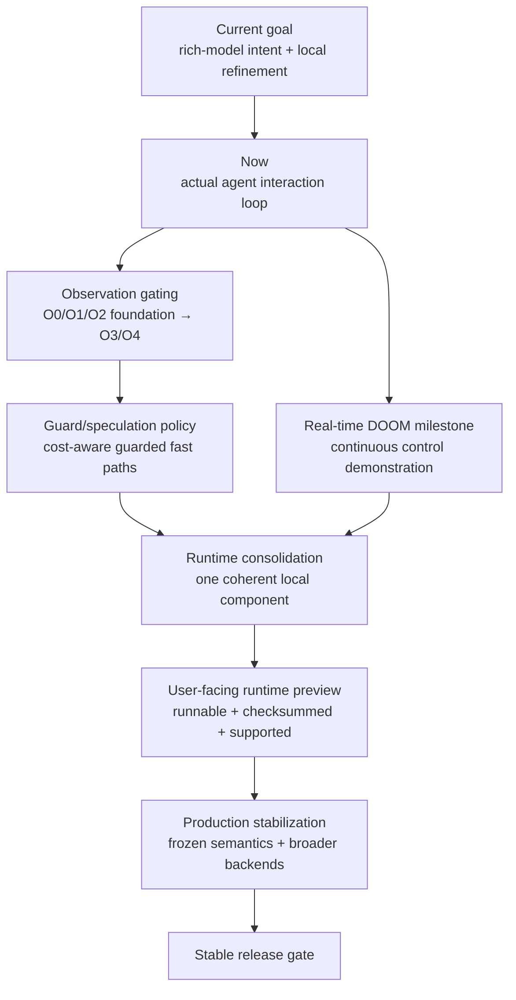

# Roadmap

This roadmap is ordered by research uncertainty, not by feature count.

## Current checkpoint — 2026-11-21 (main `63449e8abed5938a780de22cabc160aefd9d3326`)
**Research Preview RC1 setup and doctor (R05, 2026-11-21):** The frozen RC1 checkout installed its nine pinned Python dependencies successfully into an isolated WSL venv. Its doctor exited 1: 12/15 checks passed; the required Windows Codex CLI JS and WSL Chromium were absent, making the `codex_cli` check fail as a consequence. No app/runtime/model acquisition or GUI action occurred. This is a reproducible setup HOLD, not a golden run or preview acceptance. See [R05 evidence](research/integration/research_preview_rc1_setup_doctor_r05_20261121/RESULT.md). Issue #58 remains open.

**Whole-repository membership refresh r154 (2026-11-21):** On main `8c71a6199bd51ca6b38aa02cb92d9833c3260a67`, the complete paginated open sets are still 1,643 Issues and 410 PRs, exactly matching r153/r152 membership; main was unchanged before and after. This is queue membership only, not semantic triage or merge readiness. The current organization plan records this comparison; no bulk closure follows. #5130 is the one-time six-task Mindustry three-arm economics allocation under #57, still gated on its frozen source/resource conditions; #7924 remains the explicit WSLc migration STOP.

The active completion goal is to qualify the distributable runtime and the
research gates below; this roadmap is a navigation/status summary, not a new
experiment allocation.

- **Portable package:** Windows and Ubuntu WSL deterministic package/startup
  checks pass 21/21 normally and under `-O`; outside-checkout `doctor` and
  `validate --help` pass with side-effect authority disabled. See the
  [earlier package packet](research/integration/portable_runtime_distribution_v2_current_main_20261121/RESULT.md).
  PR #10377 added a second independently rebuilt package pinned to runtime
  source main `acbdfc0f9`; its tests pass 21/21 normally and under `-O` on
  Windows, the outside-checkout CLI starts on Windows and WSL, and 64/64
  source hashes audit clean. The evidence-only merge did not change runtime
  source. See the [current-main packet](research/integration/portable_runtime_distribution_v2_current_main_acbdfc0f9_20261121/RESULT.md).
  This does not establish live X11/Win32 input, task effect, public release,
  or research-preview acceptance.
- **Mindustry setup:** the pinned v160.2 JAR and both canonical saves match
  their recorded sizes and hashes. The full JAR archive CRC check passes, but
  Ubuntu WSL has no Java runtime, so the game was not launched. See the
  [asset-readiness packet](research/integration/mindustry_asset_readiness_v1_20261121/RESULT.md).
- **Integrated control and efficiency:** Issue [#57](https://github.com/Unjuno/agent-interface/issues/57)
  remains open for recovered-task success on the standard caller, repeated
  reliability, and matched all-attempt model/provider token, latency, and
  correctness accounting. Single MAP01 effects and the late-usage adapter do
  not close these gates.
- **Research Preview:** Issue [#58](https://github.com/Unjuno/agent-interface/issues/58)
  remains open. A current-main read-only launcher preflight passed 19/19 on a
  fresh sparse Ubuntu WSL ext4 checkout; the Windows-mounted checkout retained
  four line-ending/worktree-byte failures. This is not the frozen RC1 host
  acceptance. The release sequence in [`release/README.md`](release/README.md)
  still requires setup/doctor, retained audit, one fresh no-retry persistent
  run, and `audit-live`. See the
  [preflight packet](research/integration/research_preview_preflight_current_main_20261121/RESULT.md)
  and latest Issue #58 acceptance record.
- **Allocation and queue:** #5130's named Docker CPU lane and #7924's WSLc
  client ownership remain unresolved; #908 is a consumed historical HOLD.
  PR #10340 remains a non-dispatching draft without an external allocation
  attestor. The latest whole-repository membership snapshot is
  [r153](docs/maintenance/repository-inventory-recheck-20261121-r153.md):
  1,643 open Issues and 410 open PRs, unchanged from r152. This is not semantic
  triage and does not justify bulk closure.

**Whole-repository membership refresh r155 (2026-11-21):** On main
`63449e8abed5938a780de22cabc160aefd9d3326`, complete paginated REST reads found
1,643 open Issues and 409 open PRs. Issue IDs exactly match r152; the only PR
membership delta is #10218 removed. PR #10377 was opened and merged during the
interval but had no residual membership effect. This is queue membership only,
not semantic triage or merge readiness; no bulk closure follows. See the
[r155 receipt](docs/maintenance/repository-inventory-recheck-20261121-r155.md).

**Issue #57 isolated X11 delayed-input gate (2026-11-21):** WSL TCP-only Xvfb
recheck R01 is retained as `HOLD_TRANSPORT_IDENTITY`: XRes could not map the
remote client to a unique PID, so the queue discriminator did not run. The
separate Docker private-Unix-socket Xvfb pair R02b passes in normal and `-O`:
both runs confirmed owner disconnect, held-key readback, independent release,
no delayed KeyPress at 8.5 s, and final all-keys-up. This is synthetic XTEST
evidence only. Standard caller recovery, task effect/success, reliability,
matched efficiency and live MAP01 remain open. See the
[R01 packet](research/integration/standard_mcp_task_ledger_57_v1/current_main_xvfb_tcp_queue_recheck_20261121_r01/RESULT.md)
and [R02b packet](research/integration/standard_mcp_task_ledger_57_v1/current_main_docker_xvfb_unix_queue_recheck_20261121_r02b/RESULT.md).

**Issue #57 standard caller blocked-release result (2026-11-21):** The current
public MCP/Xvfb path reproduced a 150 ms XRes supervision timeout in optimized
mode 4/4 attempts; each remained UNKNOWN and skipped release. A one-second
diagnostic returned XRes disconnect in 199.5 ms. During the deliberately
withheld cancel acknowledgement, the old A key remained held and generated
repeated A KeyPress/KeyRelease effects; the scheduled delayed B KeyPress was
not observed. The evidence-backed 500 ms
candidate passed the exact standard-caller test and XRes unit suite in normal
and `-O`: it returned a bounded pending response, verified release, retained
the old operation as UNKNOWN/no-replay, and reported the old task as failed from repeated effects while A remained
held through the cancel acknowledgement (effect count 1→4 normal, 1→19
optimized); the scheduled delayed B KeyPress was not observed. A distinct fresh-generation task
passed exactly once with no old-input contamination. See the
[R01–R04 baseline/diagnostic packets](research/integration/standard_mcp_task_ledger_57_v1/current_main_standard_mcp_xvfb_blocked_release_recheck_20261121_r01/RESULT.md)
and the [500 ms candidate packet](research/integration/standard_mcp_task_ledger_57_v1/current_main_standard_mcp_xvfb_blocked_release_candidate_500ms_20261121_r01/RESULT.md).
This candidate improves bounded recovery evidence; delayed effects on the
original task remain a failed gate. #57 stays open.

The next work must advance one scoped gate at a time, retain failures and
unknowns, and re-read current source and ownership before any live or shared
resource action.

For active task priority, use [CURRENT_GOAL](docs/CURRENT_GOAL.md) and the
[worker work map](docs/WORKER_WORK_MAP.md). The current maintainer priority is
repository convergence that enables independent research and verified integration;
computer control and human-tempo operation remain unresolved objectives.
The [native Win32 fixture UI trial](research/integration/win32_native_fixture_live_20261026_r01/RESULT.md)
adds one scoped current-main click/text/save effect and verified-release sample;
MAP01/real-game transfer, standard-caller composition, blocked-I/O recovery,
matched efficiency, and reliability remain open.
The [R270 current-main public-caller attempt](research/integration/map01_r270_current_main_caller_start_20261116/REPORT.md) exposes a prestart deadline boundary: producer startup took 30.031 s against a 30 s lease, so all program operations stayed not-started and the source action remains UNKNOWN. Fresh-session R272 recovery reconciled custody as not_dispatched and fenced the generation. This is not a caller/automatic pair or task-effect/efficiency result; #57 remains open. The [R266 automatic MAP01 expiry trial](research/integration/map01_r266_current_main_expiry_20261116/REPORT.md) separately passed scoped release, delayed-operation exclusion and calibrated HUD-effect gates once, with a result-metadata deviation.
The fresh current-main [MAP01 expiry pair R198/R199](research/integration/map01_win32_current_main_expiry_r198_r199_20261116/REPORT.md) now includes a corrected preregistered single-action effect/recovery result (R199: 50→49, confirmed release and neutral horizons). R198's stale source-projection expectation remains recorded as a condition deviation. This narrows the live-control boundary but does not satisfy #57's matched model/provider lifecycle accounting, reliability or task-completion gates.
The later unused [R264 expiry freeze audit](research/integration/map01_r264_expiry_freeze_audit_20261117/REPORT.md) found that its frozen runner implements exception recovery rather than the described 30 s expiry/60 s delayed-input trial; its source pin also predates 37 changed runtime files. R264 was not run. R266 now supplies one fresh current-main automatic expiry/effect observation; its result-label defects and the missing caller/provider efficiency comparison remain open.
The separate [expiry-caller block R241/R242 audit](research/integration/map01_win32_expiry_caller_r241_r242_20261115/REPORT.md) preserves a scoped R241 automatic-monitor pass and R242 public-caller pre-input failure. The preregistered stop rule was applied, leaving R243–R248 unattempted. The pair used old source and R242's initial raw manifest has custody gaps; it establishes no current-main pair or efficiency result.
The separate [Freedoom MAP01 probes](research/integration/win32_freedoom_map01_live_20261026/README.md)
show one scoped forward effect with a verified runtime release receipt. Two
fresh input attempts showed material scene motion through the +2 s sample and
failed the preregistered sampled-settle gate; a fresh zero-input control stayed
stable over the same nominal interval. This supports input-associated delayed
application/game response but does not prove causality or qualify continuous
stop timing, blocked-I/O release, recovery, standard-caller integration, or task
success.
The subsequent [R04 held-callback cancellation run](research/integration/win32_freedoom_blocked_cancel_map01_20261026_r04/RESULT.md)
passed one live standard-caller cancellation/recovery trial: the hook callback
returned after cancellation released it, recovery completed within its runtime
deadline, release was confirmed, replay was denied, and a generation-bound MAP01
effect passed an independent oracle. R01–R03 remain retained observation misses.
This is one scoped result, not a reliability rate, MAP01 clear, or efficiency
comparison; the full raw packet remains local and its manifest hash is published
with the sanitized derivative.
[Issue #59](https://github.com/Unjuno/agent-interface/issues/59) tracks real-time
control. Neither this roadmap nor an unchecked item grants a new allocation or
changes a retained result.

Integration direction recorded 2026-09-19: [integrate one usable desktop path](docs/INTEGRATION_PLAN.md)
from the existing components, following [the updated goal](docs/CURRENT_GOAL.md)
and Issue #57. Other contributors continue research/benchmarks; this task focuses
on setup, observation, guarded action, useful results and recovery through one
coherent entry path. Use the
[convergence review](research/evolution/freeze_criteria.md) to end discovery;
the sections below remain a backlog, not automatic implementation instructions.
## Roadmap at a glance

This diagram is a reading/promotion map of the existing sections, not a claim that every item must execute serially or that a later box is already qualified.

## Now — actual agent interaction loop

The scoped O1/O2 studies and actual assistant use are summarized in the
[research handoff](docs/LOCAL_RESEARCH_HANDOFF.md). Local feedback in tens of
milliseconds has not yet produced a human-like end-to-end operating tempo.

Public-path checkpoint (2026-09-30): [the retained six-task comparison](runtime/results/public-six-task-comparison-04/README.md)
completed direct and guarded public MCP routes with six exact-once saves each.
This fills the completed public direct-baseline accounting gap, while overall
integration remains HOLD: one final image lacks the completion cue, image delivery
and capture placement differ, and serial order plus growing context prevent causal
speed/token ranking. Useful-feedback onset, broad reliability and human tempo
remain open; the historical allocations and checklist below are unchanged.

- [ ] Persistent asynchronous execution and incremental observations.
- [ ] Bounded input holds, cancellation/release and stale-state handling.
- [ ] Guarded local progress that eliminates unnecessary agent/tool round trips.
- [ ] Same-model live measurements of task quality, completion latency and actual tokens.
- [ ] Comparable human operating-tempo measurements.

## Observation Gating — scoped foundation and remaining work

Goal: remove visual/model input that carries no new task-relevant information while keeping correctness as a hard gate.

- [x] Freeze O0: full screenshot after each logical step (A1 scoped baseline).
- [x] Add O1: exact unchanged-frame suppression (A1 scoped pass).
- [x] Add O2: exact changed-tile / spatial-delta feedback (A2 transport-only pass).
- [ ] Add O3: relevant-region gating.
- [ ] Add O4: local `VERIFY` before model escalation.
- [x] Measure local action-to-first-feedback latency; full agent latency remains open.
- [x] Measure image-observation elimination at equal correctness in A1's four-app suite.
- [x] Stress tiny but semantically important changes so approximate hashes cannot silently hide them ([#1564 retained scoped PASS](research/measurement/observation_tiny_change_ahash_v1/REPORT.md)).

Active track: [`research/observation_gating/`](research/observation_gating/).

## Next — automatic speculation and guard policy

- [ ] Estimate guard cost vs `P(stale) × failure cost` per route.
- [ ] Automatically select pre-execution guard vs postcondition-only verification.
- [ ] Continue separating binding, precondition, route, observation-cache, and motor-calibration lifetimes.
- [ ] Run longer multi-app sessions with focus drift, window replacement, modal transitions, and geometry changes.

## Demonstration milestone — real-time DOOM

User direction (2026-09-13): once the live control foundation is usable, have
the assistant play DOOM in real time and develop a Product Hunt demonstration.
This extends the human-like operating-tempo objective; it does not replace
ordinary desktop task correctness or establish that capability by itself.

- [ ] Establish persistent observation/action delivery, bounded held inputs,
  cancellation/release and stale-observation handling before an extended run.
- [ ] Start with navigation and turning, then navigation under moving threats,
  then a short repeatable gameplay objective. The assistant chooses actions
  from current visual observations through Agent Interface.
- [ ] Keep the game progressing at ordinary wall-clock speed during reasoning.
  Report game speed, render rate, capture rate, observation age, decision rate,
  action duration and action-to-visible-effect latency separately.
- [ ] Compare interfaces with the same model, map/seed schedule, difficulty,
  resolution and action capabilities. Keep failed episodes and measure success,
  survival/progress, actual tokens and end-to-end time; human comparison needs
  an actual comparable human run.
- [ ] Record an uninterrupted real-time master video with synchronized input,
  observation and decision traces. A short Product Hunt edit should link to the
  full run and disclose model, local controller responsibilities and settings.
- [ ] Verify reproducible setup and usable distribution before publication.

Candidate instrumentation: [ViZDoom](https://github.com/Farama-Foundation/ViZDoom).
Its [mode documentation](https://vizdoom.farama.org/api/cpp/enums/) distinguishes
synchronous modes that wait for the agent from asynchronous modes that advance
without waiting. Use asynchronous ordinary-speed execution for the real-time
claim. A direct screen-buffer/action API experiment must be labeled separately
from an OS screen-capture and keyboard/mouse demonstration. Keep privileged
game state out of the visual controller; any scoring-only instrumentation is
separate. A [first ViZDoom/Freedoom basic-room integration](research/doom/README.md)
now exists, including assistant-operated completion and an async-clock probe.
The broader real-time gameplay demonstration remains unfinished.

## Runtime consolidation

Goal: turn promoted research semantics into one coherent component without freezing the architecture too early.

- [ ] Consolidate promoted primitives under `runtime/`.
- [ ] Provide a model/vendor-neutral local boundary.
- [ ] Add a thin CLI for setup, inspection, and demos.
- [ ] Keep deterministic fast loops local; do not fork a CLI process per action.
- [ ] Expose immediate/incremental feedback so the agent is not blocked on unnecessary waits.
- [ ] Preserve Universal Control as the fallback floor.

## User-facing runtime preview

A GitHub Release is cut only when a user can actually download and try it.

Required before the first runtime preview:

- [ ] runnable package or executable archive;
- [ ] checksum;
- [ ] minimal quickstart;
- [ ] supported OS/backend statement;
- [ ] smoke test / self-check;
- [ ] correctness gate across multiple real apps;
- [ ] recovery semantics and observation gating integrated;
- [ ] link from the release to the research evidence supporting the promoted behavior.

See [`release/README.md`](release/README.md).

## Later — production stabilization

- [ ] Freeze executable IR and error taxonomy.
- [ ] Port the frozen hot path to a systems implementation.
- [ ] Native backends beyond X11.
- [ ] Actual model-in-loop measurements: model calls, text tokens, image tokens, end-to-end latency.
- [ ] Broader app/toolkit suite and external reproduction.

## Stable release gate

A stable release requires substantially frozen protocol/execution semantics, explicit recovery behavior, cross-platform evidence, and a support envelope that is narrower than the evidence rather than broader than it.

**Issue #57 late-usage/native-owner composition (PR #10385, merged 2026-11-21 as `ecb0f037`):** Paired synthetic runs show late usage from a timeout attempt composes with a later action attempt and identity-bound public owner release/horizon receipt: positive 28/5 complete versus missing-usage control incomplete/null. Both eligible task outcomes remain UNKNOWN. Normal/-O focused adapter tests pass 12/12; exact-main audit verifies 24 raw references and 44 manifest entries. This closes only the offline composition seam; live provider exhaustiveness, owner truth, task/recovery success, efficiency and release gates remain open. See [R01 evidence](research/integration/standard_mcp_task_ledger_57_v1/late_usage_native_owner_composition_20261121_r01/RESULT.md).

**Issue #57 caller/comparator evidence join (PR #10373, merged 2026-11-21 as `428a38eaac2dce07c7b7557985ec58a998d8736b`):** The research adapter now maps complete recorder receipts into the comparison measurement schema with disk hash verification and fail-closed missing evidence. The merged tree passes 33/33 focused attribution/comparison/adapter tests normally and under `-O`; two GitHub checks passed and formal was skipped. This is not live caller/provider evidence or a matched efficiency/reliability result. The next gate is identity-bound native owner lifecycle evidence plus exhaustive provider-attempt reconciliation; see the [retained adapter packet](research/integration/standard_mcp_task_ledger_57_v1/recorded_comparison_adapter_v1/RESULT.md).

**Golden-v3 cleanup/task outcome boundary (2026-11-21; exact main `dd206c8e`):** A deterministic adapter probe and the existing focused suite show the intentional fail-closed mapping: when cleanup fails, public qualified status is `cleanup_failed` and top-level `task_success=false`, even if the raw application result recorded `task_success=true`; `program_completed=true` and the raw task assertion remain available. The focused suite passes 13/13 in normal and `-O`, including `test_cleanup_failure_cannot_succeed`. Treat this as an explicit two-layer contract, not an implementation bug or proof the app task succeeded after cleanup. Keep cleanup qualification and raw application evidence separate in comparisons; no schema change is justified by this probe alone. See [R01 evidence](research/integration/standard_task_cleanup_result_semantics_20261121_r01/RESULT.md).

**G10 public stdio current-main recheck (2026-11-21; tested source `5dab476e`, current main `704ea90c`):** After materializing the exact pinned G10 FODS fixtures in this sparse checkout, `runtime.cli_v1.test_mcp_g10_production_stdio` passed 3/3 normally and 3/3 under `-O`. The public MCP/stdio ledger records two archived-byte fixture effects verified, input release verified, owner close closed and replay denied; provider usage remains unknown. The first R01 attempt in this checkout failed before reliable assessment because the sparse tree omitted `first.fods`; its failure logs are retained separately and are not pooled with the R02 pass. Exact code/fixture pins still match main after the documentation-only crosswalk merge. This is Fake X plus archived FODS, not live Calc/provider evidence or efficiency. See [R01/R02 packet](../research/integration/issue57_g10_currentmain_stdio_recheck_20261121/RESULT.md). #57 still needs a permitted prospective live lifecycle comparison and the broader task/recovery gates.
