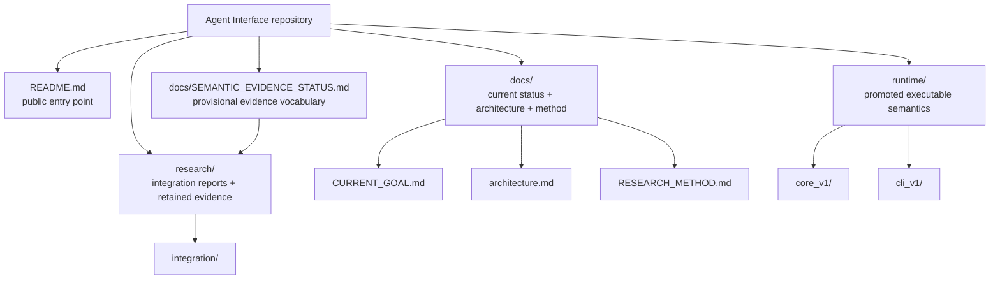

# Documentation

This directory is the public documentation map for Agent Interface. It organizes the existing project record; the linked research reports and retained artifacts remain the evidence source.

## Start here

| Question | Canonical document |
|---|---|
| How are the repository and Issue backlog being consolidated? | [REPOSITORY_CONSOLIDATION.md](REPOSITORY_CONSOLIDATION.md) |
| What sequence and exit criteria will make repository work parallelizable? | [REPOSITORY_CLEANUP_PLAN.md](REPOSITORY_CLEANUP_PLAN.md) |
| What finite work can a worker select without reading all history? | [WORKER_WORK_MAP.md](WORKER_WORK_MAP.md) |
| How should a worker start, avoid overlap, and hand off safely? | [WORKER_QUICKSTART.md](WORKER_QUICKSTART.md) |
| What is the project trying to do? | [Project README](../README.md) and [principles](principles.md) |
| What is the current research objective? | [CURRENT_GOAL.md](CURRENT_GOAL.md) |
| What ideas have been proposed and what happened to them? | [IDEAS_AND_OUTCOMES.md](IDEAS_AND_OUTCOMES.md) |
| What architecture is currently promoted? | [architecture.md](architecture.md) |
| What has been measured so far? | [PROGRESS_FROM_BASELINE.md](PROGRESS_FROM_BASELINE.md) |
| Where are preserved experiment reports and raw evidence? | [Research workspace](../research/) and [integration reports](../research/integration/) |
| Where are retained failures and research handoffs? | [LOCAL_RESEARCH_HANDOFF.md](LOCAL_RESEARCH_HANDOFF.md); refresh current ownership through [Worker Quickstart](WORKER_QUICKSTART.md) |
| What remains before the next project milestone? | [ROADMAP.md](../ROADMAP.md) |
| What runtime implementations and checks exist? | [Core runtime](../runtime/core_v1/README.md), [CLI](../runtime/cli_v1/README.md), and [guarded X11](../runtime/guarded_x11_v1/README.md) |
| How should a question be split between analysis and experiment? | [RESEARCH_METHOD.md](RESEARCH_METHOD.md) |
| How do current goal, evidence, runtime, and release documents relate? | [EVIDENCE_MAP.md](EVIDENCE_MAP.md) |
| What do recurring terms like GHD, authority lease, HOLD, and PROMOTED mean here? | [TERMINOLOGY.md](TERMINOLOGY.md) |


## Repository structure



The arrows show the intended reading/promotion direction, not code dependencies.

## Document authority map

```mermaid
flowchart TD
    CUR[Current / canonical guidance]
    SUP[Supporting design / vocabulary]
    HIST[Retained review / provisional history]
    PRES[Presentation / launch notes]

    CUR --> G[CURRENT_GOAL.md]
    CUR --> P[principles.md]
    CUR --> A[architecture.md]
    CUR --> M[RESEARCH_METHOD.md]
    CUR --> E[EVIDENCE_MAP.md]
    CUR --> PROG[PROGRESS_FROM_BASELINE.md]

    SUP --> T[TERMINOLOGY.md]
    SUP --> DT[design-theses.md]
    SUP --> CC[control-codec.md]

    HIST --> CAR[CANDIDATE_ARCHITECTURE_REVIEW.md]
    HIST --> SES[SEMANTIC_EVIDENCE_STATUS.md]
    HIST --> MAINT[maintenance/ receipts + inventories]

    PRES --> PH[product-hunt.md]
```



Use current/canonical documents for present project direction and architecture. Supporting, historical, provisional, and presentation documents remain useful context but do not override newer canonical guidance or retained evidence.

| Document / area | Role | Authority for current state |
|---|---|---|
| [`CURRENT_GOAL.md`](CURRENT_GOAL.md) | Governing objective and newest direction | **Canonical** |
| [`WORKER_WORK_MAP.md`](WORKER_WORK_MAP.md) | Narrow work candidates, exit evidence and collision boundaries | Navigation; not assignments or resource grants |
| [`principles.md`](principles.md) | Thesis and durable design constraints | **Canonical design guidance** |
| [`architecture.md`](architecture.md) | Current promoted architecture description | **Canonical architecture guidance** |
| [`RESEARCH_METHOD.md`](RESEARCH_METHOD.md) | Analysis-vs-experiment workflow | **Canonical research-method guidance** |
| [`EVIDENCE_MAP.md`](EVIDENCE_MAP.md) | Navigation among current goal, evidence, and runtime | **Canonical navigation** |
| [`PROGRESS_FROM_BASELINE.md`](PROGRESS_FROM_BASELINE.md) | Evidence-backed progress and remaining gaps | Current summary; **not a release claim** |
| [`LOCAL_RESEARCH_HANDOFF.md`](LOCAL_RESEARCH_HANDOFF.md) | Retained research handoff and chronology, with a freshness note | Research context; selected Issue updates and the linked coordination logs provide current ownership |
| [`TERMINOLOGY.md`](TERMINOLOGY.md) | Non-normative index to canonical definitions | Supporting only |
| [`design-theses.md`](design-theses.md) | Durable idea/thesis ledger | Supporting; does not override current goal/architecture |
| [`IDEAS_AND_OUTCOMES.md`](IDEAS_AND_OUTCOMES.md) | Issue-centered summary of ideas and dispositions; links to authoritative evidence | Navigation only; not a result/evidence source |
| [`control-codec.md`](control-codec.md) | Compact-control research/design note | Supporting; **not stable runtime protocol** |
| [`CANDIDATE_ARCHITECTURE_REVIEW.md`](CANDIDATE_ARCHITECTURE_REVIEW.md) | Review of an earlier candidate report/baseline | Retained review material |
| [`SEMANTIC_EVIDENCE_STATUS.md`](SEMANTIC_EVIDENCE_STATUS.md) | Provisional 2026-09-13 vocabulary/evaluation intake | Provisional/retained; not frozen ABI |
| [`maintenance/`](maintenance/) | Dated inventories and cleanup receipts | Snapshot/receipt only; recheck live state before disposition |
| [`product-hunt.md`](product-hunt.md) | Presentation/launch positioning | Presentation only |

## Documentation layers

### Living history documents

`CURRENT_GOAL.md`, `INTEGRATION_PLAN.md` and `WORKER_QUICKSTART.md` are short current entry points. Their exact pre-cleanup Git contents are preserved alongside them in [goal history](CURRENT_GOAL_HISTORY_20261015.md), [integration history](INTEGRATION_HISTORY_20261015.md) and [quickstart history](WORKER_QUICKSTART_HISTORY_20261015.md), with [source identities](maintenance/entry-history-20261015.json). Keeping the archives in the same directory preserves relative-path resolution. Historical directions and allocations are not fresh worker instructions. `LOCAL_RESEARCH_HANDOFF.md` remains a detailed chronology; open it only for the selected question.
### Current status

- [CURRENT_GOAL.md](CURRENT_GOAL.md) — current governing invariant and active research direction.
- [PROGRESS_FROM_BASELINE.md](PROGRESS_FROM_BASELINE.md) — evidence-backed progress, measured bottlenecks, and remaining gates.
- [LOCAL_RESEARCH_HANDOFF.md](LOCAL_RESEARCH_HANDOFF.md) — detailed running handoff across experiments and failures.

### Design and architecture

- [principles.md](principles.md) — project thesis and component principles.
- [architecture.md](architecture.md) — current promoted architecture.
- [CANDIDATE_ARCHITECTURE_REVIEW.md](CANDIDATE_ARCHITECTURE_REVIEW.md) — architecture review material.
- [design-theses.md](design-theses.md) — design theses retained for reference.
- [control-codec.md](control-codec.md) — control-codec design notes.

### Research and evidence

- [RESEARCH_METHOD.md](RESEARCH_METHOD.md) — analytical-first decision flow: prove/model exact semantics first, measure only the empirical residual.
- [EVIDENCE_MAP.md](EVIDENCE_MAP.md) — public map from current goal through retained evidence, convergence, runtime, and release.
- [TERMINOLOGY.md](TERMINOLOGY.md) — non-normative term index pointing to canonical definitions.
- [../research/](../research/) — preserved research reports, experiment sources, raw summaries, audits, and retained negative results.
- [../research/integration/](../research/integration/) — integration reports and retained caller evidence.

### Runtime and release

- [../runtime/core_v1/README.md](../runtime/core_v1/README.md) — promoted core runtime contract and checks.
- [../runtime/cli_v1/README.md](../runtime/cli_v1/README.md) — CLI runtime entry point and checks.
- [../runtime/guarded_x11_v1/README.md](../runtime/guarded_x11_v1/README.md) — guarded X11 implementation and limits.
- [product-hunt.md](product-hunt.md) — launch/presentation notes; not a research-status source.

### Retained and provisional context

- [SEMANTIC_EVIDENCE_STATUS.md](SEMANTIC_EVIDENCE_STATUS.md) — provisional 2026-09-13 vocabulary/evaluation intake; not current status or frozen ABI.

### Retained public-entry detail

- [PUBLIC_README_DETAILS.md](PUBLIC_README_DETAILS.md) — extended material moved out of the root README to keep the public entry concise; retained for continuity/provenance.

### Coordination records

- [maintenance/](maintenance/) — dated inventory and cleanup records. These are snapshots, not the canonical statement of live ownership.

## Suggested reading order

```text
README.md
  -> docs/CURRENT_GOAL.md
  -> docs/architecture.md
  -> docs/PROGRESS_FROM_BASELINE.md
  -> research/integration/
  -> individual research reports / raw evidence
```

For current claims, prefer the canonical documents above over inferring status from directory names or historical experiment filenames.

- [Repository cleanup inventory — 2026-10-05](BRANCH_INVENTORY_20261005.md) preserves a dated branch snapshot for historical reference; recheck all refs before cleanup.
